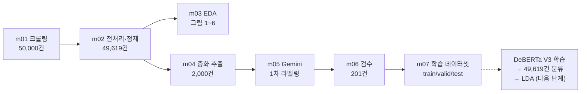

# 20년 사이 판타지 독자의 평가 기준은 어떻게 바뀌었나
### Goodreads 2000년대·2020년대 출간 판타지 도서 독자 리뷰 감성 분석

> 캡스톤프로젝트3 · 데이터 분석 프로젝트 (문장 분류)
> 데이터: Goodreads 영어 리뷰 50,000건 수집 → 전처리 후 49,619건 · 라벨링 학습 데이터 2,000건
> 모델(예정): DeBERTa V3 (영어 데이터)


---

## 목차
1. [문제 정의와 결론 가설](#1-문제-정의와-결론-가설)
2. [데이터 확보](#2-데이터-확보)
3. [원본 데이터 탐색적 분석(EDA)](#3-원본-데이터-탐색적-분석eda)
4. [데이터 라벨링 정의](#4-데이터-라벨링-정의)
5. [데이터 라벨링 과정](#5-데이터-라벨링-과정)
6. [학습 데이터셋 구축 결과](#6-학습-데이터셋-구축-결과)
7. [한계와 다음 단계](#7-한계와-다음-단계)
8. [폴더 구조와 실행 방법](#8-폴더-구조와-실행-방법)

---

## 1. 문제 정의와 결론 가설

### 무엇을 해결하려 하는가
판타지는 20년 사이 크게 변했다. 2000년대에는 해리 포터, 트와일라잇, 퍼시 잭슨 같은 블록버스터와 정통 에픽 판타지가 시장을 이끌었다. 2020년대에는 로맨스가 결합된 판타지, 다양한 문화권 신화를 바탕으로 한 작품이 늘었고, 독자 리뷰 문화도 SNS와 함께 달라졌다.

이 프로젝트는 **"같은 플랫폼(Goodreads)에서 2000년대 출간작과 2020년대 출간작은 독자에게 어떤 기준으로 칭찬받고, 어떤 이유로 비판받는가?"**를 묻는다. 별점만으로는 *왜* 좋고 나쁜지 알 수 없다. 그래서 리뷰 문장을 긍정/부정/중립/관계없음으로 분류하는 모델을 만든다. 그다음 감성별로 리뷰가 무엇을 이야기하는지(토픽)를 시대별로 비교한다.

이 결과는 작가·출판사에게는 "요즘 독자가 무엇을 기준으로 판단하는가", 독자·추천 서비스에게는 "오래된 책과 새 책을 다르게 소개해야 하는가"에 대한 근거가 된다.

### 결론 가설
> **2000년대 출간작은 '추억과 재독'으로 평가받고, 2020년대 출간작은 '요소별 체크리스트'(캐릭터·트로프·세계관·로맨스)로 평가받는다.**

EDA에서 이 방향을 뒷받침하는 신호를 먼저 확인했다([그림 5](#그림-5-평가-요소-언급률)). 2000년대 출간작 리뷰는 '재독(reread)' 언급이 3.9배, '어린 시절·향수' 언급이 5.4배 많았다. 2020년대 출간작 리뷰는 '트로프' 5.5배, '세계관' 3.3배, '로맨스' 3.0배였다. 이를 바탕으로 아래 세 가설을 모델 분류 결과와 토픽 모델링으로 검증한다.

| 가설 | 내용 | 검증 방법 |
|---|---|---|
| **H1** 칭찬의 근거 | 긍정 리뷰에서 2000년대는 재독·향수 토픽이, 2020년대는 캐릭터·로맨스·트로프 토픽이 두드러진다 | 긍정 리뷰만 모아 시대별 LDA 토픽 비교 |
| **H2** 비판의 근거 | 부정 리뷰에서 2000년대는 분량·전개(지루함, "slog")가, 2020년대는 캐릭터 몰입 실패·트로프 불만이 주된 이유다 | 부정 리뷰만 모아 시대별 LDA 토픽 비교 |
| **H3** 리뷰 문화 | 2020년대 출간작에 '관계없음'(증정본 고지, 독서 챌린지 기록, "리뷰는 나중에" 등) 리뷰 비율이 더 높다 | 모델이 분류한 라벨 비율을 시대별로 비교 |

---

## 2. 데이터 확보

### 2-1. 수집 대상과 방법
| 항목 | 내용 |
|---|---|
| 출처 | [Goodreads](https://www.goodreads.com) 도서별 리뷰 페이지 |
| 대상 | 판타지 도서 17권: 2000~2005년 출간 9권, 2020~2023년 출간 8권 |
| 시대 구분 기준 | **책의 최초 출간 연도** (리뷰 작성 연도가 아님) |
| 수집 도구 | Python + Selenium (Chrome), `m01_crawl_goodreads.py` |
| 수집 필드 | 책 제목, 최초 출간 연도, 시대(decade), 별점(1~5), 리뷰 본문 |
| 수집 조건 | 영어 리뷰만 (`langdetect`), 20자 미만 제외, 같은 책 안 중복 본문 제외 |
| 수집하지 않은 정보 | 리뷰어 이름·프로필·ID·위치 등 개인 정보 일체 |
| 접근 원칙 | 로그인·CAPTCHA·접근 제한을 우회하지 않음, 일반 브라우저 화면 이동만 사용 |
| 최종 확보 | **50,000건** (2000년대 23,175건 / 2020년대 26,825건) |

**수집 도서 목록**

| 시대 | 도서 (출간 연도) |
|---|---|
| 2000년대 | Harry Potter and the Goblet of Fire (2000), A Storm of Swords (2000), American Gods (2001), Crossroads of Twilight (2002), Harry Potter and the Order of the Phoenix (2003), Naked Empire (2003), A Feast for Crows (2005), The Lightning Thief (2005), Twilight (2005) |
| 2020년대 | The Shadows Between Us (2020), The Trouble with Peace (2020), Woven in Moonlight (2020), Elatsoe (2020), Jade Legacy (2021), The Wisdom of Crowds (2021), Nothing but Blackened Teeth (2021), Iron Flame (2023) |

> 리뷰가 적게 열리는 책(A Storm of Swords, Naked Empire, Iron Flame, Woven in Moonlight)은 수집량을 그 시점에서 고정했다. 부족분은 같은 시대의 다른 책으로 채웠다.

### 2-2. 데이터 파이프라인



### 2-3. 전처리·정제 (`m02_preprocess.py`)

| 단계 | 처리 | 남은 건수 | 제거 |
|---|---|---:|---:|
| 원본 | – | 50,000 | – |
| 결측치 제거 | 리뷰 본문·별점이 비어 있는 행 | 50,000 | 0 |
| 텍스트 정제 | URL 제거, 연속 공백·줄바꿈 정리 | 50,000 | 0 |
| 중복 제거 | 같은 책에 같은 본문 | 50,000 | 0 |
| 짧은 리뷰 제거 | 5단어 미만 ("Absolutely magnificent." 등 감성 판단 근거가 부족) | **49,619** | 381 |

**최종 분석 데이터: 49,619건** (2000년대 23,015건 / 2020년대 26,604건). 권장 기준 25,000건의 약 2배다.

---

## 3. 원본 데이터 탐색적 분석(EDA)
`m03_eda.py` · 전처리 후 49,619건 기준

### 기초통계
| 항목 | 2000년대 출간 | 2020년대 출간 | 전체 |
|---|---:|---:|---:|
| 리뷰 수 | 23,015 | 26,604 | 49,619 |
| 도서 수 | 9 | 8 | 17 |
| 평균 별점 (표준편차) | 3.92 (1.17) | 3.84 (1.24) | 3.88 |
| 4~5점 비율 | 68.6% | 66.6% | – |
| 1~2점 비율 | 13.8% | 16.9% | – |
| 리뷰 길이 중앙값 | 74단어 | 86단어 | 80단어 |
| 리뷰 길이 평균 | 164단어 | 150단어 | – |
| 약 512토큰(≈390단어) 초과 | 10.4% | 7.8% | 9.0% |

### 그림 1. 도서별 리뷰 수


책별 리뷰 수는 221건(A Storm of Swords)부터 6,268건(The Shadows Between Us)까지 차이가 크다. 시대 전체 결과가 리뷰가 많은 몇 권에 끌려갈 수 있다. 그래서 이후 분석에서는 책별 결과도 함께 확인한다.

### 그림 2. 시대별 별점 분포


두 시대 모두 5점이 약 41%로 가장 많고, 4~5점이 3분의 2를 넘는다. Goodreads 리뷰는 긍정 쪽으로 치우쳐 있다. 이 때문에 라벨링용 표본은 별점 그룹별로 고르게 뽑았다([5-2](#5-2-라벨링용-2000건-층화-추출-m04_sample_for_labelingpy)). 2020년대가 1~2점 비율이 3.1%p 더 높지만 분포 모양은 거의 같다. **별점만으로는 두 시대의 차이가 잘 드러나지 않는다.**

### 그림 3. 리뷰 길이 분포


리뷰 길이는 수 단어부터 3,000단어 이상까지 긴 꼬리를 가진다. 약 9%가 모델 입력 한도(512토큰)를 넘는다. 모델 학습 시 최대 길이 설정과 잘린 부분 처리(앞부분 + 끝부분 사용 등)를 고려해야 한다.

### 그림 4. 도서별 평균 별점


평균 별점은 책에 따라 2.49점(Nothing but Blackened Teeth)부터 4.73점(Harry Potter and the Goblet of Fire)까지 벌어진다. 시대 간 차이(3.92 vs 3.84)보다 **책 간 차이가 훨씬 크다.** 시대 비교 결과를 해석할 때 "어떤 책을 골랐는가"의 영향을 함께 따져야 한다.

### 그림 5. 평가 요소 언급률


평가 요소별로 해당 표현이 들어간 리뷰의 비율을 비교했다(정규식 기반).

| 요소 | 2000년대 | 2020년대 | 배율 |
|---|---:|---:|---:|
| 트로프 (trope) | 0.6% | 3.4% | ×5.5 |
| 세계관 (worldbuilding) | 1.2% | 3.8% | ×3.3 |
| 로맨스 (romance) | 3.8% | 11.3% | ×3.0 |
| 증정본 (ARC/NetGalley) | 1.4% | 3.8% | ×2.8 |
| 등장인물 (character) | 35.3% | 53.0% | ×1.5 |
| 문체 (writing/prose) | 12.1% | 18.0% | ×1.5 |
| 전개 속도 (pacing/slow/boring) | 12.5% | 11.5% | ×0.9 |
| 재독 (reread) | 11.9% | 3.1% | ×0.26 |
| 어린 시절·향수 (childhood) | 4.8% | 0.9% | ×0.18 |

이 결과가 [결론 가설](#결론-가설)의 출발점이다. 2000년대 출간작 리뷰는 "다시 읽었다", "어릴 때 읽었다"처럼 **책과의 개인적 기억**을 말한다. 2020년대 출간작 리뷰는 캐릭터·트로프·세계관·로맨스처럼 **책을 요소로 나누어** 평가한다. 반면 '전개 속도'와 '과대평가(hype)'는 두 시대가 비슷했다.

### 그림 6. 시대별 특징 단어


시대별로 상대적으로 많이 나오는 단어(log-odds)를 뽑으면 상위가 거의 **인물·작가 이름**(sirius, bella, alessandra, kaul 등)이다. 리뷰가 책 고유의 내용에 강하게 묶여 있다는 뜻이다. 다음 단계의 LDA 토픽 모델링에서는 인물·지명·작가명을 불용어로 처리해야 공통 평가 요소가 드러난다.

---

## 4. 데이터 라벨링 정의

리뷰 **본문**이 **해당 책**을 어떻게 평가하는지를 기준으로 4개 라벨 중 하나를 붙인다.

| 라벨 | 정의 | 예시 (실제 리뷰) |
|---|---|---|
| **긍정** | 책에 대한 평가가 전반적으로 좋다. 추천, 만족, 재미, 감동, 기대 이상 | "Excellent trilogy, would highly recommend." |
| **부정** | 책에 대한 평가가 전반적으로 나쁘다. 실망, 지루함, 하차(DNF), 비추천 | "This was such a CHORE. I'm glad to have this one behind me." |
| **중립** | 장단점이 비슷하게 섞여 있거나, 평가 없이 줄거리 요약·사실 전달만 있다 | "Not a bad book but the hardest to read thus far, I know the next one will be much better and focused on the better characters." |
| **관계없음** | 책에 대한 평가로 볼 수 없다. 인용구만 있음, 독서 챌린지·일정 기록, "리뷰는 나중에" 예고, 외부 홍보, 책과 무관한 잡담 | "At least here goes that one reading challenge prompt." / "Check out my review of this awesome book here," |

**판단 규칙 (경계 사례)**
1. **별점이 아니라 본문으로 판단한다.** 별점 3점이라도 본문이 칭찬 위주면 긍정이다. 라벨링과 검수 모두 별점을 보지 않고 진행했다.
2. **최종 평가를 우선한다.** "초반은 지루했지만 결국 최고였다"처럼 결론이 분명하면 그 결론을 따른다. 결론 없이 장단점만 나열하면 중립이다.
3. **시리즈 리뷰는 이 책에 대한 평가를 본다.** "시리즈는 좋아하지만 이번 권은 가장 별로"는 부정이다.
4. **인용구·감상 없는 줄거리**: 인용구만 있으면 관계없음, 평가 없이 줄거리만 요약하면 중립이다.
5. **증정본(ARC) 고지**는 무시하고 나머지 본문으로 판단한다. 고지만 있고 평가가 없으면 관계없음이다.

---

## 5. 데이터 라벨링 과정

### 5-1. 전체 흐름
1. 라벨 정의와 판단 규칙 작성 (위 4장)
2. 정제 데이터 49,619건에서 2,000건 층화 추출 (`m04`)
3. Gemini API로 2,000건 1차 자동 라벨링 (`m05`)
4. 시대별 약 100건, 총 201건 검수 (`m06`): 본인 1차 검수 → 중립·관계없음 경계 사례 54건은 Claude가 2차 판단
5. 검수 결과를 반영해 최종 라벨 확정, AI 1차 라벨과 검수 라벨의 일치율 측정 (`m07`)

### 5-2. 라벨링용 2,000건 층화 추출 (`m04_sample_for_labeling.py`)
원본은 4~5점 리뷰가 약 68%라서, 무작위로 뽑으면 부정·중립 예시가 부족해진다. 그래서 **시대 × 별점 그룹**으로 나누어 고르게 뽑았다.

| 시대 | 1~2점 | 3점 | 4~5점 | 합계 |
|---|---:|---:|---:|---:|
| 2000년대 | 333 | 333 | 334 | 1,000 |
| 2020년대 | 333 | 333 | 334 | 1,000 |
| 합계 | 666 | 666 | 668 | **2,000** |

별점 그룹은 **고르게 뽑기 위한 기준일 뿐, 라벨로 쓰지 않는다.** 라벨은 본문을 읽고 따로 붙인다(random_state=42로 재현 가능).

### 5-3. 1차 자동 라벨링 (`m05_auto_label_gemini.py`)
| 항목 | 설정 |
|---|---|
| 모델 | `gemini-3.1-flash-lite` (Google Gemini API, 무료 등급) |
| 입력 | 리뷰 본문만. **별점은 모델에 보내지 않음** (라벨이 별점을 베끼지 않도록) |
| 지시문 | 4장의 라벨 정의를 그대로 시스템 지시문으로 사용 |
| 요청 방식 | 리뷰 10건을 번호를 붙여 한 번에 보내고, 라벨 10개를 JSON 배열로 받음 (출력 값을 4개 라벨로 제한, 무료 등급 요청 한도 대응) |
| 긴 리뷰 | 500단어를 넘으면 앞 400단어 + 끝 100단어만 전달 (평가는 보통 처음과 끝에 있음) |
| temperature | 0 (같은 입력에 같은 답) |
| 후처리 | 라벨 개수가 리뷰 수와 다르면 그 묶음을 다시 요청. 리뷰 속 성적·폭력 묘사로 응답이 차단되면 1건씩 다시 요청하고, 끝까지 차단된 리뷰는 '확인필요'로 표시해 본인 검수 대상에 포함 (차단 묶음 3개, 끝까지 차단된 리뷰 **2건**) |
| 안전 필터 | 분류 작업이므로 안전 필터 차단 기준을 `BLOCK_NONE`으로 설정 |

### 5-4. 검수 (`m06_make_review_sheet.py`)
- **대상:** 201건. 시대별로 AI 라벨 비율대로 약 100건씩 뽑았다(라벨마다 일치율을 보기 위해). 여기에 AI가 끝내 라벨을 붙이지 못한 2건을 더했다.
- **방법:** 엑셀 시트에서 리뷰 본문을 읽고 `my_label`에 라벨을 입력했다. 선입견이 생기지 않도록 **별점은 시트에서 뺐다.**
- **진행 과정 (2단계)**
  1. **본인 1차 검수 (201건):** 본문을 읽고 판단했다. 이 과정에서 본인은 긍정·부정 두 가지로만 판단했다. 그 결과 AI가 긍정·부정이라고 한 147건은 모두 같은 판단이었다. AI가 중립·관계없음·확인필요로 둔 54건은 긍정/부정으로 바꾸거나(50건) 비워 두었다(4건).
  2. **경계 사례 2차 판단 (54건):** 라벨 체계가 4개인데 본인 검수에 중립·관계없음이 하나도 없으면 라벨 기준과 맞지 않는다. 그래서 이 54건은 **Claude(AI 어시스턴트)가 4장의 판단 규칙에 따라 다시 판단**했고, 본인이 그 결과를 최종 라벨로 채택했다. 시트의 `reviewer` 열에 `본인`(147건) / `Claude 2차(본인 위임)`(54건)으로 구분해 기록했다.
- 검수한 201건은 AI 1차 라벨 대신 검수 라벨을 최종 라벨로 쓴다.

### 5-5. 검수 결과: AI 1차 라벨 vs 검수 라벨
AI가 라벨을 붙인 199건 기준 (끝까지 차단된 2건은 비교 대상이 없어 제외)

| 항목 | 값 |
|---|---|
| 비교 건수 | 199건 |
| 일치 건수 / 일치율 | **179건 / 89.9%** |
| 2000년대 일치율 | 87.9% |
| 2020년대 일치율 | 92.0% |
| AI 라벨별 일치율 | 긍정 100% (75건), 부정 100% (72건), 중립 60.9% (46건), 관계없음 66.7% (6건) |


**AI의 긍정·부정 판단은 검수와 모두 일치했다. 엇갈린 20건은 전부 AI가 중립·관계없음이라고 한 리뷰에서 나왔다.**
- AI 중립 → 긍정 10건: 단점을 말하지만 결론이 분명히 좋은 리뷰. 예: "Much to cringe at, but a compelling narrative.", "Good beginning, good end. Too much Umbridge in the middle."
- AI 중립 → 부정 8건: 장점을 하나 언급하지만 전체 평가는 나쁜 리뷰. 예: "It was fine. Not good, not scary, not fun but it was fairly unique."
- AI 관계없음 → 부정 2건: 짧지만 책을 비판하는 리뷰. 예: "There's about 50 pages of a Richard knows best monologue."

즉 AI는 장단점이 섞이면 중립으로 보는 경향이 있었다. 검수에서는 **결론을 우선한다**는 판단 규칙(4장 규칙 2)을 적용했다. 중립 경계는 모델이 학습하기에도 가장 어려운 부분이므로, 모델 평가 때 중립 클래스의 성능을 따로 확인한다.

---

## 6. 학습 데이터셋 구축 결과

### 6-1. 최종 데이터셋 (`data/labeling/goodreads_labeled_2k.csv`)
| 컬럼 | 설명 |
|---|---|
| `sample_id` | 표본 ID (S0001~S2000) |
| `book_title`, `first_published_year`, `decade` | 책 정보 |
| `star_rating` | 별점 (분석용, 학습 입력에는 사용 안 함) |
| `review_text` | 정제된 리뷰 본문 (**모델 입력**) |
| `AI_label` | Gemini 1차 라벨 |
| `my_label` | 검수 라벨 (검수한 201건만, 5-4 참고) |
| `final_label`, `label_id` | **최종 라벨** (긍정 0 / 부정 1 / 중립 2 / 관계없음 3) |
| `label_source` | `직접 검수`(201건) 또는 `AI 1차`(1,799건) |

### 6-2. 라벨 분포
| 시대 | 긍정 | 부정 | 중립 | 관계없음 | 합계 |
|---|---:|---:|---:|---:|---:|
| 2000년대 | 359 (35.9%) | 376 (37.6%) | 225 (22.5%) | 40 (4.0%) | 1,000 |
| 2020년대 | 401 (40.1%) | 358 (35.8%) | 221 (22.1%) | 20 (2.0%) | 1,000 |
| 합계 | **760** | **734** | **446** | **60** | **2,000** |

긍정·부정·중립은 학습에 충분한 수가 확보됐다. **관계없음은 60건(3.0%)으로 적다.** 별점 기준으로 고르게 뽑은 표본이라 원래 드문 유형이 적게 들어왔기 때문이다. 학습 시 클래스 가중치를 주거나, 관계없음 후보(짧은 리뷰, "review to come" 등)를 추가로 라벨링해 보강한다.

> 참고: 표본에서는 관계없음 비율이 2000년대(4.0%)가 2020년대(2.0%)보다 높았다. 가설 H3과 반대 방향이다. 다만 이 표본은 별점별로 고르게 뽑은 것이라 원래 분포와 다르다. H3은 49,619건 전체 분류 결과로 다시 검증한다.


### 6-3. 라벨과 별점의 관계


별점과 텍스트 감성은 대체로 맞지만 같지는 않다.
- 긍정 라벨의 76.4%가 4~5점, 부정 라벨의 75.9%가 1~2점이다.
- **3점 리뷰 666건 중 본문이 중립인 것은 48.3%(322건)뿐이다.** 24.5%(163건)는 긍정, 25.1%(167건)는 부정이었다.

별점 3점을 '중립'으로 바꾸어 라벨을 대신하면 3점 리뷰의 절반이 틀린 라벨을 받는다. **별점이 아니라 리뷰 본문으로 감성을 분류하는 모델이 필요한 이유**다.

### 6-4. 학습/검증/평가 분할
라벨 비율을 유지한 층화 분할(8:1:1, random_state=42)

| 세트 | 건수 | 파일 |
|---|---:|---|
| train | 1,600 | `data/labeling/train.csv` |
| valid | 200 | `data/labeling/valid.csv` |
| test | 200 | `data/labeling/test.csv` |

---

## 7. 한계와 다음 단계

### 한계
- **시대 = 출간 연도:** 리뷰 작성일은 수집하지 않았다. 따라서 "2000년대 독자"가 아니라 **"2000년대 출간작에 현재까지 달린 리뷰"**를 비교한다. 재독·향수 표현이 많은 것도 출간 후 시간이 흐른 효과일 수 있다.
- **도서 선정의 영향:** 시대당 8~9권이다. 그림 4·6처럼 책 하나의 성격이 시대 결과를 크게 좌우할 수 있다. 장르 폭도 넓다(YA, 에픽, 그림다크, 호러 성향 등). 결과는 책별로도 함께 확인한다.
- **키워드 언급률은 단순 정규식:** 그림 5는 방향을 보는 탐색용이다. 최종 결론은 모델 분류와 토픽 모델링으로 확인한다.
- **AI 1차 라벨:** 검수하지 않은 1,799건에는 AI 라벨이 그대로 남아 있다. 검수 일치율(89.9%)을 그 품질의 추정치로 본다. 특히 AI 중립 라벨은 검수 일치율이 60.9%로 낮아서, 검수하지 않은 중립 라벨에도 긍정·부정이 섞여 있을 수 있다.
- **검수의 일부는 AI(Claude)가 수행:** 경계 사례 54건은 본인이 아닌 Claude가 2차 판단했다(5-4). 검수 라벨 전체가 사람의 독립적 판단은 아니다.
- **관계없음 클래스 부족:** 60건(3.0%)뿐이라 모델이 이 클래스를 잘 맞히지 못할 수 있다.

### 다음 단계
1. **모델 학습:** 영어 데이터이므로 DeBERTa V3로 4클래스 분류 모델을 학습하고, test 세트로 정확도·F1을 평가한다.
2. **전체 분류:** 학습한 모델로 49,619건 전체에 라벨을 붙인다.
3. **가설 검증:** 감성별·시대별 LDA 토픽 모델링(H1·H2), 시대별 관계없음 비율 비교(H3), 필요시 키워드 네트워크 분석

---

## 8. 폴더 구조와 실행 방법

```
LPL_goodreads/
├── README.md
├── requirements.txt
├── .env.example                 # GEMINI_API_KEY=... (실제 .env는 업로드하지 않음)
├── m01_crawl_goodreads.py       # 수집 (Selenium)
├── m02_preprocess.py            # 전처리·정제
├── m03_eda.py                   # EDA 그림 1~6
├── m04_sample_for_labeling.py   # 라벨링용 2,000건 층화 추출
├── m05_auto_label_gemini.py     # Gemini 1차 라벨링
├── m06_make_review_sheet.py     # 본인 검수 시트
├── m07_build_dataset.py         # 검수 반영 → 최종 데이터셋, 그림 7~9
├── data/
│   ├── raw/                     # 원본 50,000건
│   ├── processed/               # 정제 데이터, EDA 통계
│   └── labeling/                # 표본, 라벨링 결과, train/valid/test
└── figures/                     # README 그림
```

```bash
pip install -r requirements.txt
python m02_preprocess.py
python m03_eda.py
python m04_sample_for_labeling.py
python m05_auto_label_gemini.py   # .env에 GEMINI_API_KEY 필요
python m06_make_review_sheet.py   # → review_sheet.xlsx에서 my_label 직접 입력
python m07_build_dataset.py
```
